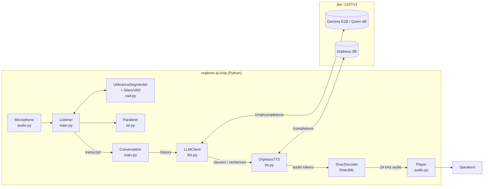
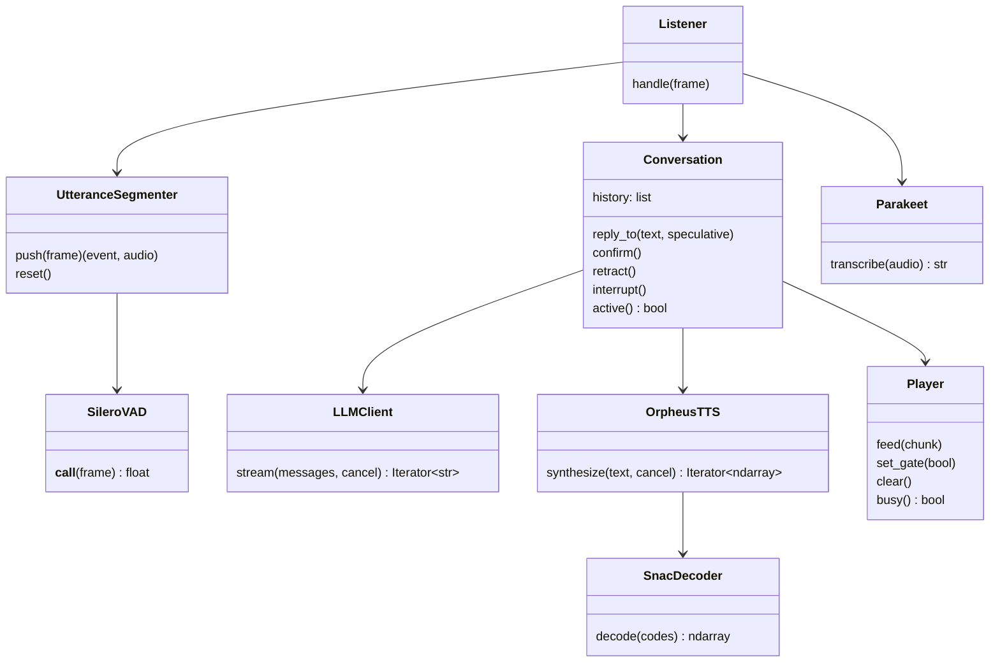
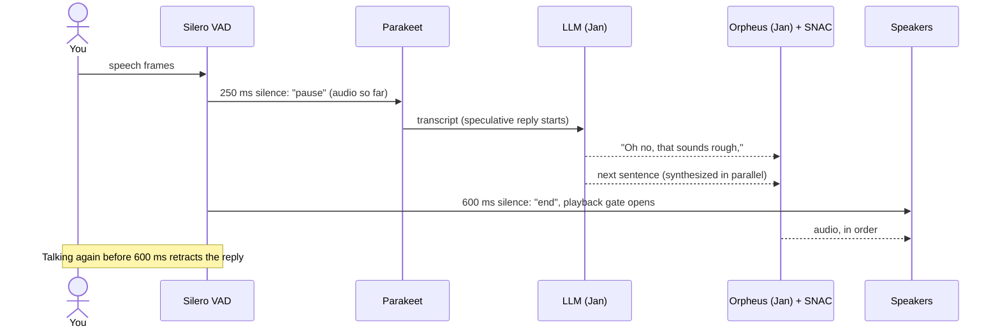

# realtime-ai-chat

Talk to a local LLM and hear it talk back, in real time. Everything runs on your machine with no cloud APIs.

| Stage | Model | Runs on |
|---|---|---|
| Voice activity detection | [Silero VAD](https://github.com/snakers4/silero-vad) (ONNX) | CPU |
| Speech → text | [NVIDIA Parakeet TDT 0.6B v2](https://huggingface.co/nvidia/parakeet-tdt-0.6b-v2) via its [ONNX port](https://huggingface.co/istupakov/parakeet-tdt-0.6b-v2-onnx) (no NeMo) | CPU (int8) |
| Thinking | Any chat model in [Jan](https://jan.ai). Default: `Qwen3_5-4B-IQ4_XS` | GPU (Jan / llama.cpp) |
| Text → speech (default) | [Kokoro-82M](https://huggingface.co/hexgrad/Kokoro-82M) via [kokoro-onnx](https://github.com/thewh1teagle/kokoro-onnx) | GPU (CUDA), or CPU |
| Text → speech (`--tts orpheus`) | [Orpheus 3B](https://huggingface.co/lex-au/Orpheus-3b-FT-Q4_K_M.gguf) Q4_K_M + [SNAC](https://huggingface.co/onnx-community/snac_24khz-ONNX) decoder (ONNX) | GPU (Jan) + GPU (SNAC, DirectML) |

No PyTorch, NeMo or CUDA toolkit needed. Outside Jan, everything is ONNX Runtime; its CUDA and cuDNN libraries come as pip packages (~1.3 GB).

There are three ways to use it:
- **`realtime-chat-web`**: the same voice chat with a browser UI at http://127.0.0.1:8890. It shows when it's listening, hearing you, thinking or speaking, gives live captions of your speech, reveals the reply word by word in sync with the audio, and lets you pick the model for each stage (STT, LLM, TTS, voice) while it runs.
- **`realtime-chat`**: the terminal version.
- **`realtime-chat-server`**: OpenAI-compatible STT + TTS endpoints, so [Open WebUI](https://github.com/open-webui/open-webui)'s voice call mode can use Parakeet and Orpheus.

## How it works

1. **Silero VAD** listens in 32 ms frames. After **250 ms** of silence, Parakeet transcribes what you said and a reply starts *speculatively*. At **600 ms** the turn is confirmed and playback is allowed. If you keep talking, the speculative reply is thrown away.
2. **The LLM** streams its reply. It's prompted to open with a short reaction ("Oh no, that sounds rough,"), and that clause is sent to TTS on its own so speech can start early.
3. **Orpheus** turns each chunk into audio tokens. SNAC decodes them in growing batches (1 → 2 → 4 → 8 frames). Two chunks are synthesized at once, because Jan batches them for ~1.5× the throughput of one, and they play strictly in order.
4. **The player** holds back just enough of each chunk to avoid stalls, based on the measured Orpheus speed (`duration × (1 − speed)`), because Orpheus runs slightly below real time on an 8 GB laptop GPU.

### Architecture



### Class diagram



### One conversational turn



## Quick start (Windows)

One command from the repo folder installs everything and opens the web UI:

```powershell
powershell -ExecutionPolicy Bypass -File setup.ps1
```

It does the following, skipping anything that's already done:

1. Installs [uv](https://docs.astral.sh/uv/) and the Python dependencies (Python 3.11, ~1.5 GB with the CUDA runtime, no PyTorch).
2. Installs [Jan](https://jan.ai) with winget, turns on its API server at launch, and sets "max loaded models" to 2.
3. Downloads Qwen 3.5 4B into Jan (2.5 GB, SHA-256 checked). Add `--orpheus` and/or `--gemma` for those models too.
4. Downloads Parakeet (~650 MB), Silero VAD (2 MB) and Kokoro-82M (340 MB).
5. Starts Jan and the web UI at **http://127.0.0.1:8890**.

After that, `uv run realtime-chat-web` is all you need.

**Requirements:** Windows 10/11, an NVIDIA GPU with 8 GB of VRAM (CPU-only works, but slower), ~6 GB of disk.

### What picking a model in the UI does

| Stage | On selection |
|---|---|
| Speech to text | Downloads from Hugging Face on first use (spinner while it loads) |
| Language model | Lists Jan's models. Catalog models Jan doesn't have show as **↓ download into Jan**, with a progress bar; restart Jan afterwards (section 05) so it sees them |
| Text to speech | Kokoro downloads automatically. Orpheus downloads into Jan like an LLM |

**Jan and VRAM:** with "max loaded models" set to unlimited, Jan keeps every model you've switched to in VRAM, and everything slows down. Set it to 1–2 in section 05 and press **Restart Jan**, which also frees VRAM right away.

### Use it from Open WebUI

```powershell
uv run realtime-chat-server        # http://127.0.0.1:8880/v1
```

In Open WebUI: **Admin Panel → Settings → Connections**: add Jan (`http://127.0.0.1:1337/v1`). Then go to **Admin Panel → Settings → Audio**:

| | Engine | Base URL | API key | Model | Voice |
|---|---|---|---|---|---|
| Speech-to-Text | OpenAI | `http://127.0.0.1:8880/v1` | `not-needed` | `parakeet` | |
| Text-to-Speech | OpenAI | `http://127.0.0.1:8880/v1` | `not-needed` | `tts-1` | `tara` |

Start a chat and press the call (headset) button. Open WebUI synthesizes each sentence in full before playing it (about 5 s for a 3.7 s sentence on this GPU), so expect noticeably more delay than `realtime-chat`.

## Usage

```powershell
uv run realtime-chat-web                   # web UI on http://127.0.0.1:8890
uv run realtime-chat                       # terminal version: Qwen + Kokoro (af_heart), half-duplex
uv run realtime-chat --voice am_michael    # other Kokoro voice
uv run realtime-chat --tts orpheus --voice leo   # expressive but slow on 8 GB GPUs
uv run realtime-chat --barge-in            # interrupt by talking (wear headphones!)
uv run realtime-chat --silence-ms 900      # wait longer before ending your turn
uv run realtime-chat --list-devices        # then --input-device N / --output-device N
```

| Flag | Default | Meaning |
|---|---|---|
| `--base-url` | `http://127.0.0.1:1337/v1` | OpenAI-compatible server (Jan, LM Studio, llama-server) |
| `--llm-model` | `Qwen3_5-4B-IQ4_XS` | Model ID of the chat model |
| `--tts` | `kokoro` | `kokoro` (fast, CPU) or `orpheus` (expressive, GPU via Jan) |
| `--tts-model` | `Orpheus-3b-FT-Q4_K_M` | Jan model ID of Orpheus |
| `--voice` | `af_heart` / `tara` | Kokoro: af_heart, af_bella, af_nicole, af_sarah, af_sky, am_michael, am_fenrir, am_puck, bf_emma, bf_isabella, bm_george, bm_fable. Orpheus: tara, leah, jess, leo, dan, mia, zac, zoe |
| `--speed` | `1.0` | Kokoro speaking rate |
| `--barge-in` | off | Speaking cancels the current reply |
| `--silence-ms` | `600` | Silence that ends your turn |
| `--early-ms` | `250` | Silence that starts a speculative reply (`≥ --silence-ms` disables it) |
| `--vad-threshold` | `0.5` | Speech probability needed to start a turn |
| `--prebuffer` | `0.1` | Extra jitter buffer (each chunk is also buffered automatically) |
| `--tts-parallel` | `2` | Chunks synthesized at once |
| `--stt-gpu` | off | Parakeet on the GPU (fp32, ~2.5 GB VRAM, 2.4 GB download) |
| `--api-key` | empty | Only if you set one in Jan |

**Half-duplex vs barge-in:** by default the mic is ignored while the assistant talks, so it can't hear itself through your speakers. With headphones, use `--barge-in`.

## Benchmarks

RTX 2070 Max-Q (8 GB), i7-9750H, Jan (llama.cpp b9967). Reproduce with `bench/bench.py`, `bench/parallel_tts.py` and `bench/simulate.py` (runs the real turn-taking loop on WAV files with a virtual speaker).

**Recommended setup: Qwen 3.5 4B + Kokoro-82M (default).** Kokoro runs on the CPU, so the GPU is left entirely to the LLM. Orpheus sounds more expressive (`<laugh>`, `<sigh>`), but on an 8 GB GPU it has to share with the LLM and can't keep up.

| Voice-to-voice (median, simulated) | **Kokoro (CUDA)** | Kokoro (CPU) | Orpheus (GPU) |
|---|---|---|---|
| **Qwen 3.5 4B** | **1.45–1.97 s** warm, 0.2 stalls/reply, 4.1 GB VRAM | 1.7–2.4 s | 6.2 s, 5.0 stalls |
| Gemma E2B IQ3_M | | 2.4 s (sometimes stops after its opener) | 4.5 s |

| Kokoro-82M (fp32 ONNX) | CPU (i7-9750H) | CUDA (RTX 2070 Max-Q) |
|---|---|---|
| Opening clause (~25 chars) | ~950 ms | **~330 ms** |
| Full sentence | 2.1× real time | **9.3×** real time |
| Notes | 4 → 12 threads: 1.7× → 2.1× | needs `cudnn_conv_algo_search=HEURISTIC`; the default exhaustive search re-tunes for every input length (spikes to 2.7 s). DirectML fails on a ConvTranspose |

Orpheus details (with `--tts orpheus`):

| | **Gemma E2B IQ3_M** | Qwen 3.5 4B IQ4_XS |
|---|---|---|
| Voice-to-voice, last word → first sound (median) | **4.5 s** (3.4–4.8 s once warm) | 6.2 s |
| Playback stalls per reply | **0.8** | 5.0 |
| VRAM with Orpheus | **4.7 GB** | 7.8 GB (incl. vision projector) |
| LLM first token / first sentence | 85 / 151 ms | 116 / 347 ms |
| LLM speed | ~78 tok/s | ~88 tok/s |
| Reply quality | Fine; opens with "That is…" a lot, and sometimes stops right after the opener | Better and more varied |

| Stage | Result |
|---|---|
| Silero VAD | 0.18 ms per 32 ms frame; turn ends 644 ms after you stop talking |
| Parakeet (CPU int8) | **273 ms** per 4 s utterance, 0% WER on test clips |
| Orpheus intelligibility | 0–2% WER (its speech transcribed back by Parakeet) |
| Orpheus, 1 stream (server only) | 79–90 tok/s = **0.94–0.97×** real time; needs ~82 tok/s |
| Orpheus, 2 streams (server only) | 143 tok/s total = **1.75×** |
| Orpheus while the LLM generates | **0.41–0.47×**: the GPU is the bottleneck |
| SNAC decode, 4 frames | DirectML **17 ms**, CPU 99 ms |

What moved the numbers:

| Change | Effect |
|---|---|
| 2 parallel TTS streams | 0.97× → 1.75× Orpheus throughput (server) |
| SNAC on 1 CPU thread instead of 4 (frees llama.cpp's sampler) | 2-stream throughput in-app 1.02× → 1.15× |
| Token reader on its own thread | 1.15× → 1.51× |
| SNAC on DirectML | decode 5.8× faster, CPU freed |
| Adaptive per-chunk buffering | stalls/reply 17 → <1 |
| Speculative start at 250 ms | ~0.8 s saved per turn |
| Short opening clause | first chunk ~60 → ~25 characters |

**Why STT and VAD stay on the CPU:** Silero gets one 32 ms frame at a time, and moving each frame to the GPU costs more than running it. Parakeet int8 takes ~270 ms on the CPU, and on the GPU it would need fp32 weights (~2.5 GB VRAM). That VRAM is better left to Orpheus, which is already the bottleneck.

## Project layout

```
realtime_chat/
  main.py    CLI, Listener (turn-taking), Conversation (reply pipeline)
  vad.py     Silero VAD (ONNX) + utterance segmenter (start/pause/resume/end)
  stt.py     Parakeet TDT 0.6B v2 (onnx-asr)
  llm.py     streaming chat client, system prompt, sentence/clause splitter
  tts.py     Orpheus streaming client + SNAC decoder (DirectML)
  audio.py   microphone + gated playback queue
  server.py  OpenAI-compatible /v1/audio/{transcriptions,speech}
  web.py     web UI backend: pipeline engine, live captions, word sync, model switching
  web_index.html  the web UI (single file, no build step)
  kokoro_tts.py   Kokoro-82M engine
  jan.py     Jan integration: model catalog/installer, loaded-model limit, restart
  setup_cli.py    `realtime-chat-setup`: Jan + all model downloads
setup.ps1    one-command install + launch
bench/
  bench.py         per-stage benchmarks (stt, vad, snac, llm, tts, e2e)
  parallel_tts.py  Orpheus throughput, 1 vs N streams
  simulate.py      real turn-taking loop on WAV files: latency, stalls, pause test
```

## Troubleshooting

- **Long silence before it speaks, or stutters:** close other GPU apps and make sure only the chat model and Orpheus are loaded in Jan (restart Jan to clear others).
- **"model isn't listed":** use the exact model ID shown in Jan, or restart Jan after adding a GGUF by hand.
- **It answers itself:** you're on speakers with `--barge-in`. Drop the flag or use headphones.
- **It cuts you off mid-thought:** raise `--silence-ms` (e.g. 900).
- **The LLM "thinks" out loud:** thinking is disabled through `chat_template_kwargs`, and any `<think>` blocks are stripped.
